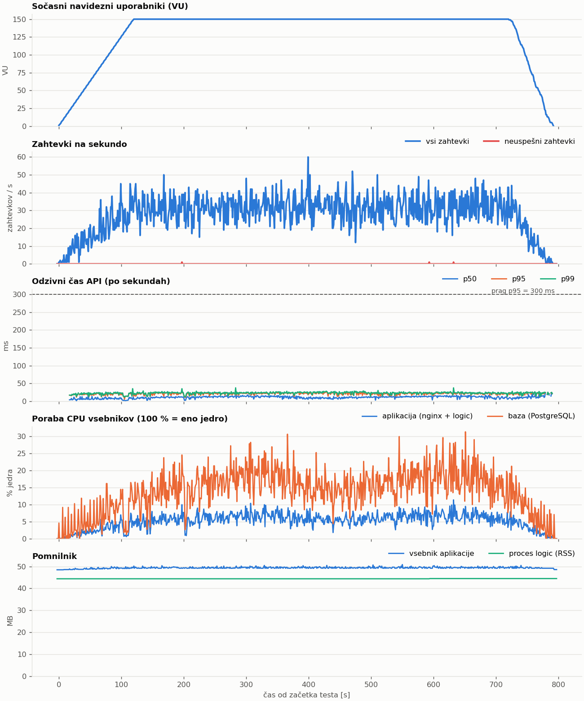
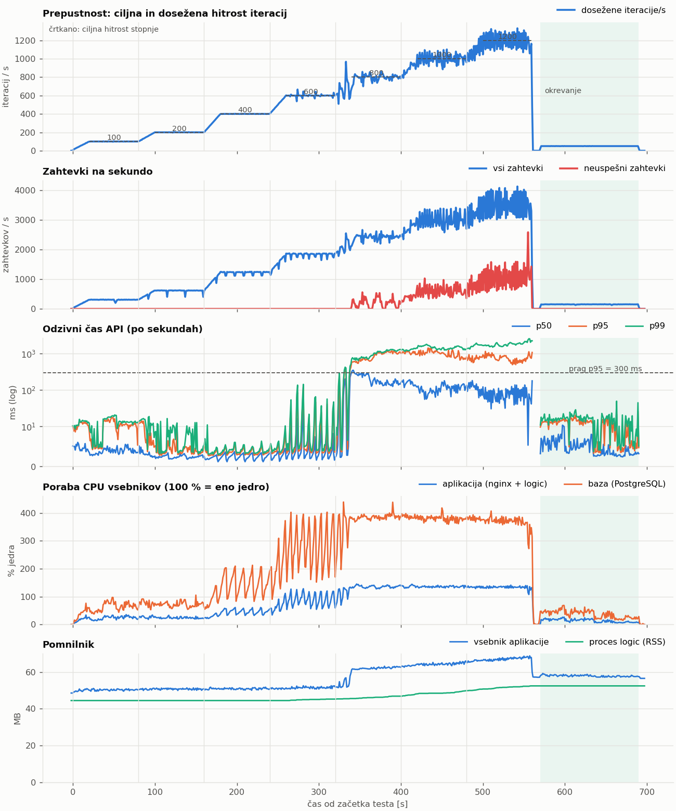

# EventEase – poročilo sistemskega testiranja (obremenitveni in stresni test)

| | |
|---|---|
| **Dokument** | Načrt in poročilo sistemskega (nefunkcionalnega) testiranja |
| **Predloga** | prirejena po ISO/IEC/IEEE 29119-3:2021 (Test Design Specification, Test Execution Log, Test Incident Report, Test Completion Report) |
| **Testirani sistem** | EventEase, različica `9c0310e` (veja `jureQA`) |
| **Orodje** | [Grafana k6](https://k6.io) v2.3.0 |
| **Izvajalec** | Jure Antolič |
| **Datum izvedbe** | 4. 11. 2026: ST-01 12:01:37–12:14:50, ST-02 12:15:14–12:26:45 |
| **Skripte** | [`tests/system/`](../../tests/system/) |
| **Dokazi** | [`dokazi/sistemski/obremenitveni/`](dokazi/sistemski/obremenitveni/), [`dokazi/sistemski/stresni/`](dokazi/sistemski/stresni/) |
| **Povezani dokumenti** | [Specifikacija funkcionalnih testov](Specifikacija_testov.md), [Poročilo funkcionalnega testiranja](Porocilo_testiranja.md) |

V ekipi je en član, zato smo izvedli dva tipa sistemskih testov: **obremenitveni test (ST-01)** in **stresni test (ST-02)**. Oba uporabljata isto orodje in isti uporabniški tok, razlikujeta pa se v profilu obremenitve, v vprašanju, na katero odgovarjata, in v kriterijih.

---

## 1. Povzetek

| Test | Vprašanje | Rezultat |
|---|---|---|
| **ST-01 Obremenitveni** | Ali sistem pri pričakovani konici (150 sočasnih uporabnikov, 10 min) izpolnjuje zahteve glede odzivnosti, napak in stabilnosti? | ✅ **USPEŠEN.** Vseh 9 kriterijev je izpolnjenih. p95 API = 23 ms (prag 300 ms), napake 0,01 %, poraba virov pod 20 % enega jedra. |
| **ST-02 Stresni** | Kje je zmogljivostna meja, kako sistem odpove in ali si opomore? | ⚠️ **DELNO USPEŠEN** (4 od 6 kriterijev). Sistem brez napak prenese **600 iteracij/s (≈ 1830 zahtevkov/s), kar je 60 × pričakovana konica**. Točka zloma je pri 800 it/s. Po razbremenitvi si opomore v manj kot 10 s, potrjeni zapisi se ne izgubijo. **Neuspešna kriterija:** ob preobremenitvi nginx prekinja povezave (136 522 × `EOF`) namesto nadzorovanega zavračanja, strežnik pa vrača HTTP 500 (234-krat). |

**Najpomembnejša ugotovitev** (SINC-01): strežnik občasno vrne **HTTP 500 pri navadnem glasovanju ali ustvarjanju ankete**. To se ne zgodi samo pod stresom, ampak tudi pri pričakovani obremenitvi (3 od 6589 glasov v ST-01). Vsak primer se ujema z eno razveljavljeno transakcijo v PostgreSQL. Najverjetnejši vzrok je generator naključnih števil za UUID, ki si ga vse niti strežnika delijo brez sinhronizacije.

---

## 2. Izbira orodja

| Orodje | Za | Proti |
|---|---|---|
| **k6** ✔ izbrano | Scenariji v JavaScriptu (enak jezik kot frontend). Vgrajeni **pragovi (thresholds)**, ki kriterij sprejemljivosti neposredno pretvorijo v izhodno kodo. Odprti (`ramping-arrival-rate`) in zaprti (`ramping-vus`) model obremenitve. Ena statična binarka (tudi Docker slika), izvoz CSV in HTML. | Brez GUI za snemanje scenarijev. Ne izvaja JavaScripta v brskalniku (za to je ločen modul `k6/browser`). |
| Apache JMeter | Zrelo, GUI, veliko vtičnikov. | Testni načrti v XML, težje za pregled v gitu. Zahteva JVM. |
| Locust | Scenariji v Pythonu, spletni vmesnik. | Samo zaprt model. Nižja zmogljivost generatorja na enem jedru. |
| Gatling, Artillery | Dobra poročila. | Scala/Java oziroma YAML; za naš primer brez prednosti pred k6. |

Odločilna je bila podpora **odprtemu modelu**, ki je za stresni test bistven. Novi uporabniki prihajajo s predpisano hitrostjo ne glede na to, kako hitro sistem odgovarja, zato počasen sistem ne zniža obremenitve samega sebe. Pomembni so bili tudi pragovi, s katerimi so kriteriji del skripte.

---

## 3. Testno okolje

| Element | Vrednost |
|---|---|
| Gostitelj | Linux x86_64 (Debian 13, jedro 6.12), 12 logičnih jeder, 62 GB RAM |
| Aplikacija | Docker Compose (projekt `eventease-qa`, prepis [`compose.qa.yaml`](../../tests/functional/compose.qa.yaml)), ena slika: nginx + Zig binarka `logic`, `http://localhost:8080`, `DISABLE_EMAILS=true` |
| Baza | PostgreSQL 16.14 (vsebnik `postgres:16-alpine`), `127.0.0.1:5433`. Pred testi: 46 anket iz funkcionalnih testov. |
| Generator obremenitve | k6 v2.3.0 (statična binarka) na **istem gostitelju** |
| Spremljanje virov | [`spremljaj_vire.py`](../../tests/system/spremljaj_vire.py): vsako sekundo bere cgroup v2 (CPU, pomnilnik vsebnika aplikacije in baze) in `/proc` (PID, RSS in niti procesa `logic`). Ne potrebuje `sudo`. |
| Stanje baze | `psql`: `pg_stat_database` (commit, rollback, deadlock) pred testom in po njem, štetje zapisov za ankete zagona |

**Pomembne nastavitve sistema** (iz kode, vplivajo na rezultate):

| Komponenta | Nastavitev | Vir |
|---|---|---|
| nginx | privzeto 1 delovni proces, `worker_connections 1024` (en zahtevek prek proxyja porabi 2 povezavi) | [nginx.conf:2](../../nginx.conf#L2) |
| httpz (Zig) | privzeto 1 worker, 32 niti za obdelavo | knjižnica httpz, `config.zig` |
| Bazen povezav pg.zig | **5 povezav**, čakanje na prosto povezavo največ 10 s | [db.zig:8](../../backend/logic/src/db.zig#L8) |

**Omejitve okolja:** test je lokalen, zato omrežne zakasnitve ni. Absolutni časi so zato nižji kot na Railway. k6 si z aplikacijo deli procesor, kar pri ST-02 nad približno 3000 req/s lahko vpliva na rezultate (glej 7.3). Vsebniki nimajo omejitev CPU ali pomnilnika, produkcija na Railway pa jih ima. Številke v tem poročilu so zato **zgornja meja** za produkcijo, ne napoved zanjo.

---

## 4. Načrt testov (določen pred izvedbo)

### 4.1 Uporabniški tok (skupen obema testoma)

Vsak navidezni uporabnik (VU) predstavlja **eno skupino**. Mešanica zahtevkov zato ustreza dejanski rabi aplikacije: na eno anketo pride 20 glasov. Tok je v [`k6/skupno.js`](../../tests/system/k6/skupno.js).

| Korak | Vloga | Zahtevki | Čas razmisleka (samo ST-01) |
|---|---|---|---|
| 1. Ustvari anketo (3–5 terminov) | organizator | `GET /`, `POST /api/polls`, `GET /api/polls/admin/:token` | 5–15 s pred oddajo |
| 2. Glasuj (×20, vsakič drug udeleženec z unikatnim imenom) | udeleženec | `GET /invite/:token`, `GET /api/polls/share/:token`, `POST …/vote` | 5–20 s izpolnjevanje, 1–3 s po oddaji |
| 2a. Predlagaj termin (10 % udeležencev) | udeleženec | `POST …/suggest` | 2–6 s |
| 3. Potrdi termin | organizator | `GET /api/polls/admin/:token`, `POST …/finalize` | 3–10 s |

Vsak odgovor preverimo (`check`): pričakovana statusna koda (201 za ustvarjanje, glas in predlog, sicer 200) in vsebina (`share_token`, `success: true`). Uspešne zapise štejemo z lastnimi števci k6. Po testu jih primerjamo s stanjem v bazi.

**Izven obsega:** pošiljanje e-pošte (izklopljeno), deljenje po e-pošti, sprejemanje predlogov, čiščenje starih anket, izvajanje JavaScripta v brskalniku.

### 4.2 ST-01 Obremenitveni test

**Namen:** potrditi, da sistem pri pričakovani konični obremenitvi deluje znotraj zahtev in da je stabilen (brez lezenja latence ali pomnilnika).

**Profil (zaprt model, `ramping-vus`):** 0 → **150 VU v 2 min**, **10 min vzdrževanja**, 1 min upadanja (skupaj 13 min). S časi razmisleka iz 4.1 to pomeni približno 10 iteracij/s oziroma 30 zahtevkov/s. Ocena 150 sočasnih uporabnikov predpostavlja, da hkrati glasuje več skupin, na primer več letnikov ene fakultete ob objavi rokov. Za študentski projekt na Railway je to radodarna ocena konice.

**Kriteriji sprejemljivosti** (O1–O6 so pragovi k6, O7–O9 izračuna [`analiza.py`](../../tests/system/analiza.py)):

| # | Kriterij | Prag |
|---|---|---|
| O1 | Delež neuspešnih zahtevkov | < 1 % |
| O2 | Odzivni čas API, p95 | < 300 ms |
| O3 | Odzivni čas API, p99 | < 800 ms |
| O4 | Statične datoteke (SPA), p95 | < 100 ms |
| O5 | Oddaja glasu, p95 | < 300 ms |
| O6 | Uspešni `check`-i | > 99 % |
| O7 | Stabilnost: p95 v zadnji minuti vzdrževanja ≤ 1,2 × p95 v prvi minuti; RSS `logic` zraste < 10 % | da |
| O8 | Celovitost: vsak potrjen (201) glas, anketa, predlog in potrditev obstaja v bazi; noben glas ni brez možnosti | da |
| O9 | Rezerva virov: povprečni CPU aplikacije in baze med vzdrževanjem | < 50 % jedra |

### 4.3 ST-02 Stresni test

**Namen:** poiskati zmogljivostno mejo (točko zloma), ugotoviti, **kako** sistem odpove, in preveriti, ali se po razbremenitvi sam povrne.

**Profil (odprt model, `ramping-arrival-rate`, brez časa razmisleka):** sedem stopenj **100 → 200 → 400 → 600 → 800 → 1000 → 1200 iteracij/s**. Vsaka stopnja ima 20 s naraščanja in 60 s vzdrževanja. Sledi 10 s premora in **2 min okrevanja pri 50 it/s** (skupaj približno 11,5 min). Ena iteracija je en korak iz 4.1, v povprečju približno 3 zahtevki. Stopnje smo izbrali po kratkem kalibracijskem zagonu (0 → 2000 it/s v 90 s), ki je pokazal prve napake okoli 800 it/s ([`stresni_stopnje.json`](../../tests/system/k6/stresni_stopnje.json)). Do 3000 navideznih uporabnikov.

**Merjene metrike** (za vsako stopnjo, samo v fazi vzdrževanja): dosežena hitrost iteracij in zahtevkov, delež napak po vrsti (prekinjena povezava, 5xx), p50/p95/p99 API, zavržene iteracije (k6 ni imel prostega VU), CPU in pomnilnik vsebnikov, PID procesa `logic`, rollbacki in deadlocki v bazi.

**Kriteriji:**

| # | Kriterij | Prag |
|---|---|---|
| K1 | Zmogljivostna rezerva: največja stopnja, kjer je p95 API < 300 ms in napake < 1 % | ≥ 100 it/s (10 × pričakovana konica ST-01) |
| K2 | Točka zloma: prva stopnja s p95 > 1000 ms ali napakami > 5 % | določena (informativno) |
| K3 | Nadzorovana degradacija: `logic` se ne sesuje (isti PID), pomnilnik ostane omejen, presežek se zavrne z odgovorom (HTTP 503/429) in ne s prekinjeno povezavo | da |
| K4 | Okrevanje: v 60 s po razbremenitvi p95 API < 300 ms in napake < 1 % (prag k6 za scenarij `okrevanje`) | da |
| K5 | Celovitost: noben potrjen zapis ni izgubljen; v bazi ni več glasov kot poskusov; noben glas ni brez možnosti | da |
| K6 | Brez notranjih napak strežnika: število odgovorov HTTP 500 | 0 |

---

## 5. Rezultati ST-01 (obremenitveni test)

Zagon `obremenitveni-20261104T120134`: 22 252 zahtevkov, 7281 iteracij, 417 anket, 6589 glasov, 275 potrditev. k6 izhodna koda **0** (vsi pragovi izpolnjeni).

| # | Kriterij | Prag | Izmerjeno | |
|---|---|---|---|---|
| O1 | Neuspešni zahtevki | < 1 % | 0,01 % (3 / 22 252, vsi HTTP 500 pri glasu) | ✅ |
| O2 | API p95 | < 300 ms | 23,4 ms | ✅ |
| O3 | API p99 | < 800 ms | 26,1 ms | ✅ |
| O4 | Statično p95 | < 100 ms | 1,0 ms | ✅ |
| O5 | Glas p95 | < 300 ms | 25,0 ms | ✅ |
| O6 | Uspešni `check`-i | > 99 % | 99,97 % | ✅ |
| O7 | Stabilnost | ≤ 1,2× / < 10 % | p95 23,5 → 22,6 ms; RSS 44,4 → 44,5 MB | ✅ |
| O8 | Celovitost | da | 6586 potrjenih glasov = 6586 v bazi; ankete 417 = 417; predlogi 684 = 684; potrditve 275 = 275 | ✅ |
| O9 | CPU | < 50 % jedra | aplikacija 6,1 %, baza 16,3 % | ✅ |

Med vzdrževanjem je sistem obdelal povprečno 31,8 zahtevka/s. Odzivni čas in pomnilnik sta bila ves čas ravna (graf spodaj). **Kljub uspešnemu testu so 3 glasovi vrnili HTTP 500**, obenem pa sta v bazi nastala natanko 3 rollbacki (SINC-01).

| Končna točka | Zahtevkov | Napak | p50 | p95 | p99 |
|---|---|---|---|---|---|
| `GET /invite/:token` (SPA) | 6589 | 0 | 0,8 ms | 1,0 ms | 1,2 ms |
| `GET /api/polls/share/:token` | 6589 | 0 | 9,4 ms | 19,1 ms | 21,2 ms |
| `POST …/vote` | 6589 | 3 | 13,2 ms | 25,0 ms | 27,0 ms |
| `GET /api/polls/admin/:token` | 692 | 0 | 5,2 ms | 23,3 ms | 25,0 ms |
| `POST …/suggest` | 684 | 0 | 4,5 ms | 15,5 ms | 17,0 ms |
| `POST /api/polls` | 417 | 0 | 9,2 ms | 20,5 ms | 22,5 ms |
| `POST …/finalize` | 275 | 0 | 6,2 ms | 17,4 ms | 18,3 ms |



---

## 6. Rezultati ST-02 (stresni test)

Zagon `stresni-20261104T121511`: 1 011 122 zahtevkov in 335 972 iteracij v 11,5 min. k6 izhodna koda 0 (pragova okrevanja izpolnjena).

### 6.1 Po stopnjah (faza vzdrževanja, 60 s)

| Stopnja | Cilj it/s | Doseženo it/s | Zahtevkov/s | Napake | od tega prekinjene povezave | od tega HTTP 500 | p50 | p95 | p99 | CPU aplikacija | CPU baza |
|---|---|---|---|---|---|---|---|---|---|---|---|
| 1 | 100 | 100 | 306 | 0 % | 0 | 0 | 3,7 ms | 11 ms | 16 ms | 24 % | 64 % |
| 2 | 200 | 200 | 608 | 0 % | 0 | 0 | 2,5 ms | 4 ms | 8 ms | 24 % | 72 % |
| 3 | 400 | 400 | 1221 | 0 % | 0 | 0 | 2,5 ms | 4 ms | 5 ms | 46 % | 146 % |
| 4 | 600 | 600 | 1830 | 0,01 % | 0 | 16 | 3,1 ms | 24 ms | 64 ms | 89 % | 281 % |
| **5** | **800** | 796 | 2418 | **8,2 %** | 11 853 | 47 | 204 ms | **896 ms** | 1188 ms | 136 % | 385 % |
| 6 | 1000 | 999 | 2985 | 20,3 % | 36 266 | 50 | 106 ms | 1037 ms | 1529 ms | 136 % | 380 % |
| 7 | 1200 | 1193 | 3507 | 31,1 % | 65 253 | 70 | 71 ms | 752 ms | 1801 ms | 133 % | 368 % |

(CPU: 100 % = eno jedro.) Vir: [`stopnje.csv`](dokazi/sistemski/stresni/stopnje.csv), [`okrevanje.csv`](dokazi/sistemski/stresni/okrevanje.csv), [`koncne_tocke.csv`](dokazi/sistemski/stresni/koncne_tocke.csv).



### 6.2 Ocena kriterijev

| # | Kriterij | Izmerjeno | |
|---|---|---|---|
| K1 | Rezerva ≥ 100 it/s | **600 it/s** (≈ 1830 req/s, 60 × konica ST-01) s p95 24 ms in 0,01 % napak | ✅ |
| K2 | Točka zloma | **800 it/s** (≈ 2400 req/s): 8,2 % napak, p95 896 ms, p99 > 1 s | ✅ določena |
| K3 | Nadzorovana degradacija | `logic` se ni sesul (PID 35613 ves čas). Pomnilnik je omejen (vsebnik do 69 MB). **Presežek pa ni bil zavrnjen z odgovorom:** vse napake ob preobremenitvi so prekinjene povezave (136 522 × `EOF`, status 0), nobena ni 503/429. Prekinjene so tudi zahteve za statične datoteke (`GET /` 17 % napak), ki ne pridejo do Zig strežnika. | ❌ (SINC-02) |
| K4 | Okrevanje v 60 s | Že prvo 10-s okno po razbremenitvi je v mejah: p95 13 ms, 0 napak. Celotna faza okrevanja: p95 13,3 ms, 0 % napak. | ✅ |
| K5 | Celovitost | 241 867 potrjenih glasov, v bazi 242 018 (≤ 293 302 poskusov), 0 glasov brez možnosti. Ankete: 15 487 potrjenih, 15 508 v bazi. | ✅ |
| K6 | 0 × HTTP 500 | **234 × HTTP 500** (vse stopnje od 600 it/s naprej). Razlika rollbackov v bazi je natanko 234, deadlockov 0. | ❌ (SINC-01) |

**K5, dopolnitev:** v bazi je 151 glasov in 21 anket več, kot jih je odjemalec dobil potrjenih. Strežnik je zapis shranil, povezava pa je bila prekinjena, preden je odgovor prišel do odjemalca. Glasovanje je po imenu idempotentno (ponovna oddaja z istim imenom glas posodobi), zato ponovni poskus ne naredi dvojnika. Pri ustvarjanju ankete pa ponovni poskus ustvari podvojeno anketo. Ta pojav je pri prekinjenih povezavah pričakovan, zato ga ne štejemo kot izgubo podatkov.

### 6.3 Analiza vzroka zloma

Iz grafov in nastavitev v poglavju 3 sledi veriga:

1. **Ozko grlo je bazen povezav (5).** CPU baze se od stopnje 5 naprej ustali pri **≈ 380–400 %**, kar ustreza 4–5 hkrati aktivnim povezavam. Zig strežnik pri tem porabi samo približno 1,3 jedra, gostitelj pa ima 12 jeder. Dodatni zahtevki čakajo na prosto povezavo, zato mediana skoči s 3 na 200 ms.
2. **Daljši odzivi pomenijo več sočasnih povezav.** Pri 800 it/s in odzivu približno 1 s je hkrati odprtih več sto zahtevkov. Vsak porabi 2 povezavi nginx (odjemalec in proxy), nginx pa ima en delovni proces z 1024 povezavami.
3. **nginx zapira povezave.** Ko omejitev povezav zmanjka, nginx novih povezav ne sprejme oziroma jih zapre. Odjemalec dobi `EOF` brez HTTP odgovora. Napake se zato pojavijo tudi pri statičnih datotekah.

Po razbremenitvi se vrste izpraznijo in sistem takoj deluje normalno (K4). Odzivni čas p95 med stopnjami 5–7 sicer **pade** (896 → 752 ms), ker nginx večji del presežka zavrne takoj.

---

## 7. Incidenti in opažanja

Resnost: **visoka** = izguba ali okvara podatkov; **srednja** = napačno obnašanje, ki ga uporabnik lahko sproži ali opazi; **nizka** = vpliva samo na zmogljivost ali vzdrževanje.

### SINC-01 Občasni HTTP 500 pri ustvarjanju zapisov (deljen generator UUID) — **srednja**

| | |
|---|---|
| **Test** | ST-01 (3×), ST-02 (234×), kalibracija (52×) |
| **Koraki** | Sočasni `POST …/vote` ali `POST /api/polls`. Pojavi se že pri približno 30 req/s. |
| **Pričakovano** | 201, zapis shranjen. |
| **Dejansko** | Občasno HTTP 500 s praznim telesom. Število 500 je v vsakem zagonu **natanko enako** prirastku `xact_rollback` v `pg_stat_database`, `deadlocks` = 0. Pogostost raste s sočasnostjo (v oknih vzdrževanja: 0 pri ≤ 400 it/s, 16 pri 600, 47–70 na stopnjo od 800 naprej). |
| **Vpliv** | Uporabnikov glas ali anketa se ne shrani. Vmesnik pokaže napako, uporabnik mora poskusiti znova. Pri pričakovani obremenitvi to zadene približno 1 od 2000 glasov. |
| **Vzrok (hipoteza)** | Vse ID-je (ankete, žetoni, termini, glasovi, možnosti glasov, predlogi) generira `uuidV4Hex` ([routes.zig:10](../../backend/logic/src/routes.zig#L10)) iz **enega** `std.Random.DefaultPrng` ([main.zig:30-33](../../backend/logic/src/main.zig#L30-L33)), ki si ga deli vseh 32 niti httpz brez zaklepanja. Xoshiro256 ni varen za sočasno uporabo: dve niti lahko prebereta isto stanje in dobita **isti UUID**, drugi `INSERT` pa pade na primarnem ključu in transakcija se razveljavi. Hipotezo podpira ujemanje 500 = rollback in to, da deadlockov ni. Dokončno jo potrdi sporočilo `duplicate key value violates unique constraint` v dnevniku vsebnika (glej 8.3). |
| **Predlog** | Za UUID uporabiti kriptografski vir, varen za niti (`std.crypto.random` oziroma `io.random`), ali `gen_random_uuid()` v bazi. Druga možnost je PRNG za vsako nit oziroma zaščita z mutexom. |

### SINC-02 Ob preobremenitvi nginx prekinja povezave namesto nadzorovanega zavračanja — **srednja**

| | |
|---|---|
| **Test** | ST-02, stopnje 5–7 |
| **Pričakovano** | Presežek zahtevkov se zavrne z odgovorom (HTTP 503 s `Retry-After` ali 429), ki ga vmesnik lahko prikaže. Statične datoteke se še naprej strežejo. |
| **Dejansko** | 136 522 zahtevkov je končalo s prekinjeno povezavo (`EOF`). Med njimi so tudi `GET /` in `GET /invite/:token` (do 17 %), torej se uporabniku stran sploh ne naloži. |
| **Vzrok** | nginx brez `worker_processes` (privzeto 1) in z `worker_connections 1024` ([nginx.conf:2](../../nginx.conf#L2)); proxy brez `keepalive` do upstreama; brez omejevanja hitrosti in čakalne vrste. Ozko grlo zadaj je bazen 5 povezav (6.3). |
| **Predlog** | `worker_processes auto;`, več `worker_connections`, `upstream` s `keepalive`. `limit_req`/`limit_conn` z odgovorom 503 za `/api/`. Velikost bazena povezav uskladiti s številom niti (npr. 10–20). V Zig strežniku pri izteku čakanja na povezavo vrniti 503 namesto 500. |

### SINC-03 Brisanje ankete je zelo počasno (manjkajoča indeksa tujih ključev) — **nizka**

| | |
|---|---|
| **Kje** | Priprava okolja: brisanje 33 239 anket kalibracije z `DELETE FROM polls …` |
| **Dejansko** | Kaskadni `DELETE` po 15 min še ni bil končan, ves čas pa je zasedal eno jedro baze. Enako brisanje po tabelah (otroci → starši) je trajalo **0,8 s**. |
| **Vzrok** | `polls.final_slot_id` (`ON DELETE SET NULL`) in `vote_options.time_slot_id` (`ON DELETE CASCADE`) nimata indeksa ([podatkovna_shema.sql](../../backend/logic/src/podatkovna_shema.sql)). Pri vsakem izbrisanem terminu baza pregleda celotno tabelo `polls`. |
| **Vpliv** | Enako brisanje izvaja [`cleanup.zig`](../../backend/logic/src/cleanup.zig) vsako uro. Z rastjo baze bo čiščenje vedno počasnejše in bo med izvajanjem obremenjevalo bazo. |
| **Predlog** | `CREATE INDEX IF NOT EXISTS idx_polls_final_slot_id ON polls(final_slot_id);` in `… ON vote_options(time_slot_id);` (idempotentno, primerno za migracijo ob zagonu). |

### Opažanja

| # | Opažanje |
|---|---|
| SO-1 | RSS procesa `logic` je med stresom zrasel s 44,5 na 52,5 MB in po razbremenitvi ostal tam. Pri ST-01 je bil v 10 min raven (+0,1 MB), zato ne gre za uhajanje pomnilnika pri normalni rabi. Verjetno gre za povečane medpomnilnike httpz. Za potrditev bi bil potreben vzdržljivostni (soak) test. |
| SO-2 | k6 je tekel na istem gostitelju. Pri stopnjah 6–7 dosežena hitrost niha okoli cilja (±10 %), zavrženih je bilo 1176 iteracij (0,35 %). Na točko zloma pri 800 it/s to ne vpliva, ker je ta jasno določena z napakami nginx in s polnim bazenom povezav. |

---

## 8. Zaključek

### 8.1 Ocena

Pri **pričakovani obremenitvi ima EventEase veliko rezervo**: odziv je približno 20 ms, poraba virov pod 20 % enega jedra, sistem pa je stabilen. Z vidika zmogljivosti je aplikacija primerna za predvideno rabo. Zmogljivostna meja (približno 1800 req/s brez napak) je dvakrat višja od največje obremenitve, ki jo realno pričakujemo. **Kakovost odpovedi pa ni dobra:** ob preobremenitvi uporabnik dobi prekinjeno povezavo, ne sporočila, neodvisno od obremenitve pa se pojavljajo redke napake 500 (SINC-01).

Priporočen vrstni red popravkov: **SINC-01** (vpliva na uporabnike že pri normalni rabi, popravek je ena vrstica) → **SINC-03** (dva indeksa, preprečita postopno degradacijo čiščenja) → **SINC-02** (nastavitve nginx in bazena povezav). Po popravkih ponovno poženemo oba testa. Pri SINC-01 mora biti v obeh testih 0 × HTTP 500.

### 8.2 Preostala tveganja

- Test na Railway ni bil izveden (omejeni viri, omrežna zakasnitev, drug Postgres). Za produkcijsko oceno bi bil potreben kratek, nizek obremenitveni test z odobritvijo lastnika.
- Vzdržljivostni test (ure) in test nenadnega porasta (spike) nista izvedena.
- Pošiljanje e-pošte je izklopljeno. V produkciji vsaka potrditev sinhrono pokliče `curl` na Resend, kar bi pri sočasnih potrditvah lahko podaljšalo zasedenost povezav.

### 8.3 Ponovitev izvedbe

```bash
# 1. Aplikacija (kot pri funkcionalnih testih)
sudo docker compose -p eventease-qa -f compose.yaml -f tests/functional/compose.qa.yaml up -d --build

# 2. Testa (k6 iz PATH ali K6=/pot/do/k6; brez k6 se uporabi Docker slika grafana/k6)
tests/system/zazeni.sh obremenitveni     # ≈ 13 min
tests/system/zazeni.sh stresni           # ≈ 12 min

# 3. Potrditev vzroka SINC-01
sudo docker logs eventease-qa-app-1 2>&1 | grep -i "PG error" | sort | uniq -c | sort -rn | head
```

Zaganjalnik zapiše v `docs/testiranje/dokazi/sistemski/<tip>/`: izpis in povzetek k6 (`k6_izpis.txt`, `k6_povzetek.json`), interaktivno poročilo k6 (`k6_porocilo.html`), časovno vrsto po sekundah, statistiko končnih točk in stopenj (`*.csv`), oceno kriterijev (`rezultat.json`) in graf. Surove meritve k6 (≈ 50 MB) so v `tests/system/surovo/` in niso v gitu. Ankete testa imajo naslov `k6-<RUN_ID>-…`, zato jih lahko ločimo od drugih podatkov.

---

## 9. Uporaba orodja Claude Code

Pri tej nalogi smo uporabili agenta **Claude Code** (model Claude Opus 5.5).

**Odločitve izvajalca** (agent je pred začetkom postavil vprašanja): tipa testov (obremenitveni in stresni), orodje k6, izvedba lokalno v Docker Compose (ne na Railway) in poročilo v Markdown.

**Kaj je naredil agent:** iz kode poiskal nastavitve, ki določajo zmogljivost (bazen 5 povezav, nginx, httpz); predlagal profile, metrike in kriterije; napisal k6 scenarije, spremljanje virov brez `sudo`, zaganjalnik in analizo z grafi; izvedel kalibracijo in oba testa ter v kodi poiskal vzroke incidentov.

**Kako smo preverili delo agenta:** prvi kalibracijski zagon je pokazal 100 % neuspešnih ustvarjanj. Vzrok je bila napačna pričakovana koda v skripti (200 namesto 201), ne napaka sistema. Pričakovane kode smo zato preverili ročno s `curl` za vse končne točke. Štetje zapisov k6 smo primerjali s štetjem v bazi, število napak 500 pa s števcem rollbackov v PostgreSQL, ki je neodvisen od k6. Grafe smo pregledali in popravili prekrivajoče se oznake.
